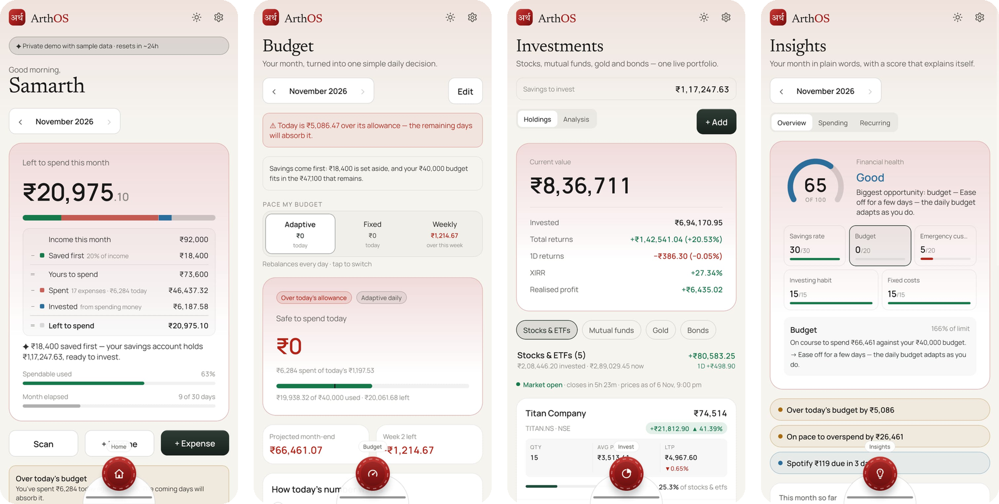
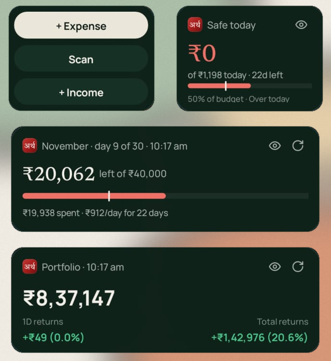
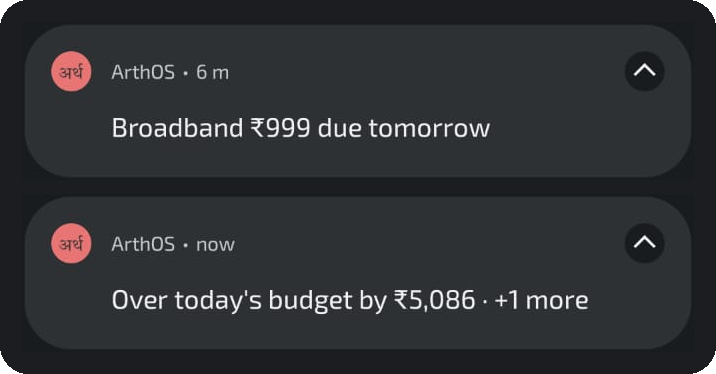

  

<h2 align="center">ArthOS for Android · v{{VERSION}}</h2>

<b>Your money in one place: income, expenses, savings, budgets and investments.</b>

  <a href="https://github.com/SamP231004/ArthOS/releases/download/android-latest/ArthOS.apk"><b>⬇️ Download ArthOS.apk</b></a>
  &nbsp;·&nbsp;
  <a href="https://os-arth.vercel.app">🌐 Open the web app</a>

### ✨ New in this build

- 🇺🇸 **US stocks**: add NASDAQ and NYSE shares and ETFs, shown in $ and ₹ in their own tab, live during US market hours
- 📥 **Import US holdings** from INDmoney or Vested
- 🏷️ **Your own categories**: rename or hide the defaults, add your own (Settings → Categories)
- 🪙 **Gold funds and gold ETFs** can count as Gold (switch in Settings)
- 📊 Per-category summary with XIRR, realised profit breakdown, sorting and a clearer savings breakdown
- 🎬 A new interactive tour, and a red `*` on required fields

### 📱 What's inside

| | |
|---|---|
| 💰 **Save first** | A share of every income goes to savings the moment it arrives, and carries forward |
| 🎯 **One number for today** | Your monthly budget as a daily amount that adapts when life happens |
| 📈 **Investments** | Indian stocks, US stocks, mutual funds, gold and bonds at live prices, with XIRR |
| 📥 **Broker import** | Zerodha, Groww, CAS, INDmoney or Vested: read on your phone, never uploaded |
| 📸 **Scan & Share** | Share a payment screenshot from Google Pay, PhonePe, Paytm or your bank app, and the expense fills itself in |
| 💡 **Insights** | A health score that explains itself, unusual spending and subscriptions, with no AI |
| 🧩 **Widgets & alerts** | Safe to spend, month snapshot, portfolio and quick add on your home screen |

<table>
  <tr>
    <td width="55%" align="center"> 🧩 Home-screen widgets</td>
    <td width="45%" align="center"> 🔔 One-line alerts</td>
  </tr>
</table>

### 📲 Install

1. Open this page **on your Android phone** and tap **ArthOS.apk** under Assets.
2. Allow **Install unknown apps** for your browser the first time.
3. Sign in with Google or email, or tap **Explore the demo**. The same account works on the web.

> Already have ArthOS from **Google Play**? Use that instead: Play keeps it updated, and the two can't be installed side by side.

Build `{{SHA}}` · Android 7.0+ · Updated automatically on every app change.

---

Forged by <b>Samarth</b> · <i>Take control of your अर्थ.</i>

