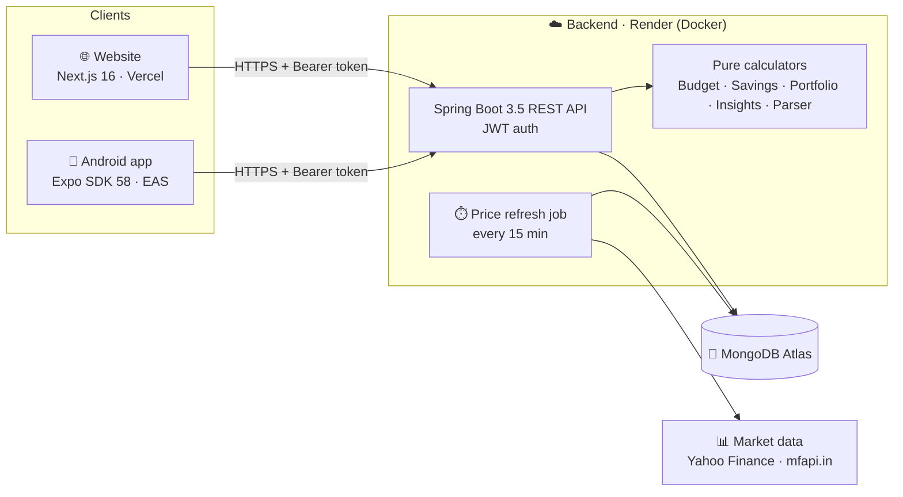

<div align="center">


# ArthOS

### Take Control of Your अर्थ

**A personal financial operating system: income, spending, budgets, savings, investments and insights in one place.**

[🌐 Live website](https://os-arth.vercel.app/) · [📱 Download the Android app](https://github.com/SamP231004/ArthOS/releases/tag/android-latest) · [📚 Documentation](#-documentation)


</div>

---

## 💡 What is ArthOS?

Most people track money in three places: salary in a bank app, spending in a notes app or spreadsheet, and
investments in a broker app. None of them answer the questions that matter day to day:

> *"How much can I spend **today**?"* · *"Am I actually saving?"* · *"Where did my money go this month?"* · *"Is my portfolio growing?"*

ArthOS brings all of it together around one simple promise:

| | |
|---|---|
| 💰 **Know what comes in** | Salary, freelance, bonuses, dividends, refunds, all logged by type. |
| 💸 **Know what goes out** | Every expense by category, merchant and payment method. Add one by scanning a screenshot. |
| 🏦 **Know what you keep** | **Save first:** a share of every income goes into a savings account the moment it arrives, and carries forward month after month. |
| 📈 **Know what grows** | Stocks, mutual funds, gold and bonds at live prices, with P&L, XIRR and allocation. |
| 🧭 **Know what to do next** | A daily spending number, a health score that explains itself, and alerts before things go wrong. |

The same account works on the **🌐 website** and the **📱 Android app**. Both talk to the same backend, so anything you add on one appears on the other immediately.

> **Try it without signing up:** tap **"Try the demo"** on the [website](https://os-arth.vercel.app/) or in the app. You get a private sandbox with six months of realistic data. It deletes itself after 24 hours.

---

## ✨ Features at a glance

| Module | What it does | Read more |
|---|---|---|
| 🏠 **Overview** | Month at a glance: income, spending, saved first, left to spend, daily trend, top categories, recent activity. | [Money model](docs/money-model.md) |
| 💰 **Income** | Log income by type (salary, freelance, bonus, interest, dividend…), mark it recurring, filter by month. | [Money model](docs/money-model.md) |
| 💸 **Expenses** | 15 categories, 7 payment sources, merchant search, filters, recurring flag, and smart category suggestions as you type. | [Automation](docs/automation.md) |
| 🎯 **Budget** | Turns a monthly limit into **one daily number**. Fixed, adaptive or weekly modes, with a calendar history and an explanation of the maths. | [Budget engine](docs/budget.md) |
| 🏦 **Savings** | Save-first rule (a % of income or a fixed amount). The savings account carries forward and funds your investments. | [Money model](docs/money-model.md) |
| 📈 **Investments** | Stocks/ETFs (NSE/BSE), mutual funds (AMFI), gold (24K/22K, digital/physical/SGB) and bonds. Live prices, P&L, XIRR, allocation, history. Each purchase can be paid from savings, spending money, or split between them. | [Investments](docs/investments.md) |
| 📸 **Scan to add** | Share a GPay/PhonePe/Paytm screenshot, bank SMS or receipt to ArthOS. The text is read **on your device** and opens a pre-filled form. | [Automation](docs/automation.md) |
| 🔁 **Recurring detection** | Finds bills and income that repeat monthly but aren't marked recurring yet. | [Automation](docs/automation.md) |
| 💡 **Insights** | The month summarised in a few lines, a **financial health score out of 100**, unusual spending, subscription leakage, alerts and suggestions. **No external AI.** | [Insights](docs/insights.md) |
| 🔔 **Notifications** | The app notifies you about budget overages and recurring bills due soon. Bills are reminded at 9 am on their due date. | [Insights](docs/insights.md#-notifications-app) |
| 🎨 **Two themes** | 🌲 **Forest** (dark) and 🕊️ **Ivory** (light), toggled with the sun/moon button. The app mirrors the website. | [Design](docs/design.md) |

---

## 🧱 How it's built



```
ArthOS/
├── backend/   ☕ Spring Boot 3.5 · Java 21 · MongoDB · JWT        → Docker on Render
├── web/       ▲  Next.js 16 · React 19 · Tailwind v4             → Vercel
├── app/       📱 Expo SDK 58 · React Native 0.88 · Expo Router   → APK via GitHub Actions + EAS
├── docs/      📚 Detailed documentation (you are here ↓)
└── ArthOS_Detailed_Product_Blueprint.docx                       → the original product spec
```

Each folder is independent, with its own dependencies, env file and deploy target. → [Tech stack & architecture](docs/tech-stack.md)

---

## 📚 Documentation

| Doc | What's inside |
|---|---|
| 🧰 [Tech stack & architecture](docs/tech-stack.md) | Every library and why, the request flow, the data model, security, and the project principles. |
| 🏦 [Money model: income, spending & save-first](docs/money-model.md) | How "saved first", "left to spend" and the carry-forward savings account are calculated. |
| 🎯 [Budget engine](docs/budget.md) | Fixed, adaptive and weekly modes, with formulas and worked examples. |
| 📈 [Investments](docs/investments.md) | Asset classes, price sources, average cost, XIRR, funding from savings, merging holdings. |
| 📸 [Automation: scan, categories & recurring](docs/automation.md) | On-device OCR, the text parser, learned categories, recurring detection, Share → ArthOS. |
| 💡 [Insights & health score](docs/insights.md) | Summaries, anomalies, leakage, the 100-point health score, alerts, notifications. |
| 🎨 [Design system](docs/design.md) | Themes, typography, the dial navigation, and how the app mirrors the website. |
| 🔌 [API reference](docs/api.md) | Every endpoint, with request and response notes. |
| 🚀 [Running & deploying](docs/deployment.md) | Local setup, environment variables, Render, Vercel, and the Android build pipeline. |
| 🗺️ [Roadmap](docs/roadmap.md) | What's shipped (Phases 1–5) and what's next (widgets, AI assistant, scale). |

---

## 📸 Screenshots

> 🚧 *Coming soon:* product screenshots of the website and app (Overview, Budget, Investments, Insights, Scan) will be added to [`docs/images/`](docs/images/).

---

## ⚡ Quick start

```bash
# 1️⃣ Backend: needs MongoDB (local, Docker, or a free Atlas cluster)
cd backend && mvn spring-boot:run              # → http://localhost:8080/api/health

# 2️⃣ Website
cd web && cp .env.example .env.local           # NEXT_PUBLIC_API_URL=http://localhost:8080
npm install && npm run dev                     # → http://localhost:3000

# 3️⃣ App
cd app && cp .env.example .env                 # EXPO_PUBLIC_API_URL=http://10.0.2.2:8080 (emulator)
npm install && npx expo run:android            # dev build (the app has native modules)
```

Full details, environment variables and deployment: [docs/deployment.md](docs/deployment.md).

---

## 🗺️ Roadmap

| Phase | Theme | Status |
|---|---|---|
| 1 | 🧱 Foundation: auth, onboarding, income, expenses, dashboard | ✅ Shipped |
| 2 | 🎯 Budget engine: fixed, adaptive, weekly | ✅ Shipped |
| 3 | 📈 Investments: stocks, MFs, gold, bonds, live prices | ✅ Shipped |
| 4 | 📸 Automation: OCR scan, smart categories, recurring detection | ✅ Shipped |
| 5 | 💡 Insights: summaries, health score, anomalies, notifications | ✅ Shipped |
| 6 | 🧩 Home-screen widgets | 🔜 Next |
| 7 | 🤖 AI assistant | 📝 Planned |
| 8 | 🚀 Scale: goals, family sharing, documents | 📝 Planned |

Details in [docs/roadmap.md](docs/roadmap.md).

---

<div align="center">


Built by **Samarth Patel** · *Understand every rupee in motion.*

</div>
