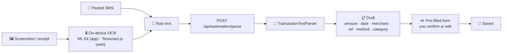

# 📸 Automation: Scan, Smart Categories & Recurring

[← Back to README](../README.md)

People stop tracking expenses because typing them in is tedious. Phase 4 cuts that work down to a single share.

| Feature | One-liner |
|---|---|
| 📸 **Scan to add** | Screenshot, SMS or receipt → pre-filled transaction |
| 📤 **Share → ArthOS** | Share straight from GPay/PhonePe/Messages into the app |
| 🏷️ **Smart categories** | Learns "Swiggy → Food" from you |
| 🔁 **Recurring detection** | Spots monthly bills you forgot to mark |

---

## 📸 Scan to add

### 🔒 Privacy first

| | |
|---|---|
| 🖼️ The image | **Never leaves your device.** Text is recognised locally. |
| 📝 What's sent | Only the recognised text, to ArthOS's own backend, for parsing. |
| 🤖 External AI | **None.** Parsing is deterministic rules. |
| ✅ Confirmation | Nothing is saved until you review the form. |

### 👁️ Text recognition

| Platform | Engine | Notes |
|---|---|---|
| 📱 Android | **Google ML Kit** text recognition 16.0.1, **bundled** in the APK | Works offline and doesn't wait for a Play Services download. Lives in a local Expo module, [`modules/arthos-ocr`](../app/modules/arthos-ocr), which decodes the image itself and applies EXIF rotation. |
| 🌐 Web | **Tesseract.js** 6 | Runs in the browser. |

### 🧠 The parser

[`TransactionTextParser`](../backend/src/main/java/com/arthos/automation/TransactionTextParser.java) is pure and
deterministic, and unit-tested against real layouts from GPay, PhonePe, Paytm, BHIM, bank apps, bank SMS and shop receipts.

| Field | How it's found |
|---|---|
| ↕️ **Income or expense** | Keywords like *paid to*, *debited*, *sent* vs *received*, *credited*. "Debited from your a/c" wins even if the SMS also says "credited to merchant". |
| 💰 **Amount** | 1️⃣ Receipts: the line labelled *grand total* / *total* / *amount paid*. 2️⃣ Currency-marked amounts (`₹`, `Rs.`, `INR`), skipping balances and cashback by checking the words just before each one ("Avl Bal Rs.48,212" is ignored). 3️⃣ Payment-app hero: a line that is just the amount. 4️⃣ SMS phrases: "debited by 1,250.00". |
| 🔣 **OCR fixes** | `₹` is often misread as `%`, `Z`, `X`, `?`, `&` or a leading `2`/`3`/`7` ("₹450" → "3450"); the parser corrects for this. Account and card numbers like `A/c XX4821`, years, 10/12-digit phone numbers and RRNs, and times are never taken as amounts. |
| 📅 **Date** | `7 Nov 2026`, `7th November, 26`, `Nov 7, 2026`, `7 Nov` (this year), numeric `07/11/26` · `07-11-2026` and ISO `2026-11-07`; falls back to today |
| 🏪 **Merchant** | *To MAHADEV DOSA CENTER*, *Paid to …*, VPA names; receipts use the shop name near the top. The name stops at the amount, date, or words like *on*/*via*/*ref*. |
| 🔖 **Reference** | UPI transaction ID / UTR / RRN |
| 💳 **Method** | UPI, card, net banking… |
| 🏷️ **Category** | From [smart categories](#-smart-categories) |

A read is only usable if it found an **amount**. A name alone could be any text.

---

## 📤 Share → ArthOS (Android)

| Step | What happens |
|---|---|
| 1 | In GPay / PhonePe / Gallery / Messages, tap **Share** → **ArthOS** |
| 2 | `expo-sharing` receives the image (`image/*`) or text (`text/plain`) and copies it to the app cache |
| 3 | Once you're signed in and navigation is ready, the app opens **Scan** with the shared item |
| 4 | OCR → parse → pre-filled form → you confirm |

---

## 🏷️ Smart categories

Two layers, checked in order:

| Priority | Source | Example |
|---|---|---|
| 1️⃣ | **What you taught ArthOS**: every saved expense with a merchant teaches `merchant → category`, and the **latest choice wins**, so a correction is remembered immediately | You file "Blinkit" as Groceries → it's Groceries from then on |
| 2️⃣ | **Built-in rules for Indian spending**, first match wins, more specific rules first | Swiggy/Zomato → Food · Uber/Ola/Rapido → Transport · Netflix/Spotify → Subscriptions · Airtel/Jio → Utilities |

| Detail | |
|---|---|
| 🔤 Merchant normalising ([`MerchantKey`](../backend/src/main/java/com/arthos/automation/MerchantKey.java)) | "SWIGGY", "Swiggy Ltd.", "swiggy@icici" → `swiggy`. UPI handle, legal suffixes and punctuation are dropped. |
| 🧩 Whole-word matching | "ola" doesn't fire inside "cola", and "auto" doesn't fire inside "automatic". |
| ⌨️ Live suggestions | The expense form suggests a category as you type the merchant. |

---

## 🔁 Recurring detection

[`RecurringDetector`](../backend/src/main/java/com/arthos/automation/RecurringDetector.java) finds bills and income
that come back every month but **aren't marked recurring yet**, and offers to mark them.

A group (same normalised merchant or source) qualifies when **all** of these hold:

| Rule | Threshold | Why |
|---|---|---|
| 📅 Appears in enough months | ≥ **2** of the recent months | A pattern, not a one-off |
| 1️⃣ About once a month | ≤ **1.5** per month on average | Daily food delivery doesn't count |
| 🗓️ Around the same date | Day-of-month spread ≤ **6** days (month-end days count as one "last day") | Bills have due dates |
| 💰 Steady amount | Every entry within **25%** of the typical amount; within **5%** if only two months | Two similar grocery runs aren't a subscription |

Recurring items then feed [Insights](insights.md): subscription totals, price rises and bill reminders.

---

## 🔌 API

| Method | Path | |
|---|---|---|
| POST | `/api/automation/parse` | `{text}` (up to 20,000 chars; the app may send several OCR readings joined) → draft + confidence |
| GET | `/api/automation/category?merchant=` | Suggested category |
| GET | `/api/automation/recurring` | Candidates not yet marked |
| POST | `/api/automation/recurring` | Mark candidates as recurring |

## 🧪 Tested by

[`TransactionTextParserTest`](../backend/src/test/java/com/arthos/automation/TransactionTextParserTest.java) ·
[`RecurringDetectorTest`](../backend/src/test/java/com/arthos/automation/RecurringDetectorTest.java)
