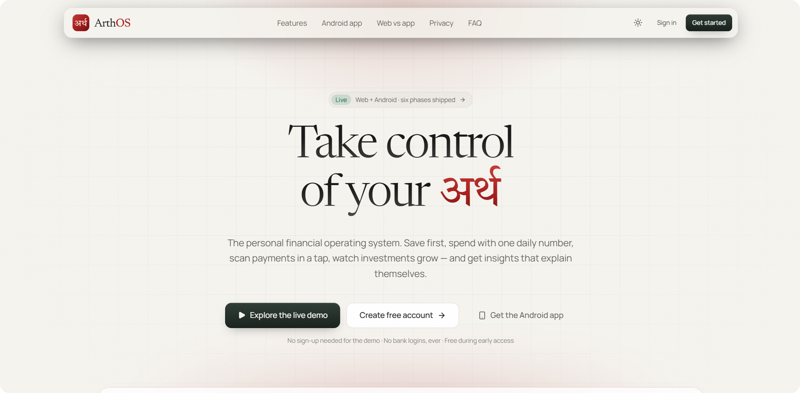

# 🎨 Design System

[← Back to README](../README.md)

ArthOS aims to feel **premium, calm and practical**, like a control panel rather than a spreadsheet. The website and
the app share one design language, and **the app mirrors the web**: same palette, wording, sections and order.

---

## 🌗 Two themes

Switch with the **☀️ / 🌙** button in the header. On Android the change is a smooth circular reveal from the button.

### 🎯 One job per colour

The rule behind the palette: **a colour that means money never decorates, and a decoration never looks like money.**

| Role | 🌲 Forest (dark) | 🕊️ Ivory (light) | Used for |
|---|---|---|---|
| ✍️ **Ink** (`brand`) | `#ECE7DB` ivory | `#1F2B25` deep forest-charcoal | Primary buttons, links, active controls, neutral data bars. Never green or red, so "+ Expense" doesn't look like "good" |
| 🌹 **Crimson identity** (`mark`, `accent`) | `#E8706A` | `#A31C1B` | Logo, the "OS" in ArthOS, active-nav marker, the mobile dial's centre, ✦ highlights. The same brand in both themes |
| 🟢 **Income / good** | `#4CC38A` | `#16794C` | Money in, gains, under budget |
| 🔴 **Expense / bad** | `#F07167` | `#B42318` | Money out, losses, over budget |
| 🟡 **Warning** | `#E8B45C` | `#A86B12` | Close to a limit |
| 🔵 **Info** | `#84B6D8` | `#2C6E9B` | Bills due, neutral notices |

| Surfaces | 🌲 Forest | 🕊️ Ivory |
|---|---|---|
| Background | `#06110C` | `#F6F4EF` paper |
| Card | `#10231A` (lifted so cards separate from the background) | `#FFFFFF` |
| Text | `#F2EFE8` ivory | `#171717` charcoal |

Base palette: **Forest Green `#06110C` · Charcoal `#171717` · Crimson `#A31C1B`**.

Colours are **tokens**: CSS variables on the web (Tailwind v4: `bg-brand`, `text-mark`, `.btn-primary` for ink, `.btn-mark` for crimson) and a `palettes` object in the app
([`app/src/theme`](../app/src/theme/index.tsx): `brand`, `mark`, `ink1/ink2/inkFg`). Components never hard-code a hex value, so both themes stay consistent.

> 🗒️ **History:** brand used to be crimson-rose in dark mode (clashing with expense red) and forest green in light mode (clashing with income green), so the brand changed between themes and buttons looked like money states. The current system fixes both.

---

## 🔤 Typography

| Role | Font | Used for |
|---|---|---|
| 🖋️ Display | **Newsreader** (serif) | Page titles, hero numbers |
| 🏷️ Section labels | Manrope, small, normal tracking | Calm labels like *Financial health* (no longer mono uppercase) |
| 🧩 UI | **Manrope** | Labels, body, buttons |
| 🔢 Numbers | **IBM Plex Mono** / tabular figures | Amounts that line up in lists |
| 🪷 Wordmark | **Tiro Devanagari Hindi** | अर्थ in *"Take Control of Your अर्थ"* |

---

## 🧭 Navigation

| Platform | Pattern |
|---|---|
| 🖥️ Web (desktop) | Left sidebar: Overview · Income · Expenses · Budget · Investments · Insights, with Settings at the bottom |
| 📱 Web (mobile) and 🤖 app | A **dial**: a rotating tab selector at the bottom. Tap or spin to switch between Home · Income · Expenses · Budget · Invest · Insights |

---

## 🧱 Patterns

| Pattern | Where |
|---|---|
| 📋 **Groww-style lists** | Clean rows with a name and subtitle on the left and the amount on the right; used for transactions and holdings in the app |
| 🃏 **Cards** with an optional glow | Summary blocks; the glow marks the most important card on a screen |
| 📅 **Month picker** | Every money screen is per month |
| 🗣️ **Explainers** | "How is this calculated?" on Budget; tap-to-expand components on the health score |
| 🏷️ **Top-3 chips** | Category filters show the top 3 categories in one row, not a crowded grid |
| 🚦 **Semantic colour** | Green = income/good, red = expense/danger, amber = caution, blue = info |
| 🔢 **₹ en-IN formatting** | ₹1,23,456 grouping everywhere |

---

## 🖼️ Assets

| Asset | Location |
|---|---|
| App icon, adaptive icon, monochrome icon | [`app/assets/images`](../app/assets/images) |
| Tab icons (@1x/@2x/@3x) | [`app/assets/images/tabIcons`](../app/assets/images/tabIcons) |
| Web icon | [`web/src/app/icon.svg`](../web/src/app/icon.svg) |
| Product screenshots | [`docs/images`](images/) *(coming soon)* |
