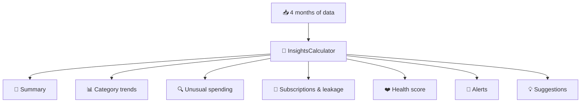

# 💡 Insights & Financial Health Score

[← Back to README](../README.md)

Insights turns a month of raw transactions into **plain-language guidance**: what changed, what looks unusual, what's
quietly draining money, and how healthy your finances are overall.

> ### 🤖 No external AI
> Insights is **ordinary rule-based code**: [`InsightsCalculator`](../backend/src/main/java/com/arthos/insights/InsightsCalculator.java).
>
> | ✅ Pros | ⚠️ Trade-offs |
> |---|---|
> | 🔒 Private: no data leaves ArthOS's server | Can't answer open questions like *"can I afford a trip in March?"* |
> | ⚡ Instant and free to run | Sentences come from templates, so they can feel repetitive |
> | 🔁 Same data always gives the same result | Only says what the rules cover |
> | 🗣️ Every number is explainable | |
>
> A conversational assistant is planned for [Phase 7](roadmap.md#-phase-7--ai-assistant).

---

## ⚙️ How it works

Each time you open Insights (`GET /api/insights?month=YYYY-MM`), the backend loads:

| Input | Why |
|---|---|
| 💸 Expenses for **this month + the 3 before** | "Usual" spending baselines |
| 💰 Incomes for the same 4 months | Savings rate, fixed-cost share |
| 🎯 The month's budget (own or inherited) | Budget score and alerts |
| 🏦 The savings account | Emergency cushion, overdrawn alert |
| 📈 Investment buy dates | Investing habit |

…and runs plain arithmetic and comparisons over them. The response has 7 sections:

| Section | How it's worked out |
|---|---|
| 📝 **Summary** | Compares this month so far with the **same days** of earlier months (1–7 Nov vs 1–7 Oct), then fills sentence templates |
| 📊 **By category** | Spending per category vs your usual amount at the same point in the month |
| 🔍 **Unusual spending** | A payment far above that category's typical (median) amount |
| 🔁 **Subscriptions** | Recurring expenses (excluding rent/EMI): monthly and yearly totals, plus price rises |
| ❤️ **Health score** | Five parts with fixed points, each with an explanation and a tip |
| 🔔 **Alerts** | Budget, savings and bill-due warnings |
| 💡 **Suggestions** | Up to 4 concrete actions, with the monthly amount they'd free up where known |

---

## 📝 Monthly summary

A few short lines. These examples are illustrative; the exact wording comes from the templates in `InsightsCalculator`:

> - You've spent **₹41,250** so far, **12% less** than usual by this date.
> - **Food** is up **32%** on usual (₹6,840 vs ₹5,180).
> - Nothing on **Shopping** yet — usually ₹3,200 by now.
> - **₹16,000** was saved first; **₹20,750** is left — about **₹897 a day**.
> - Most frequent merchant: **Swiggy**, 9 payments, ₹2,915.

| Rule | Why |
|---|---|
| 📅 Same-days comparison | Day 7 of November is compared with days 1–7 of earlier months, not with whole months, which would always look "low". |
| 🔍 A rise caused mostly by one flagged anomaly isn't called a trend | One laptop purchase doesn't mean Shopping is "up" |
| ✌️ At most 2 category rises mentioned | Keeps it readable |
| 🏪 Top merchant needs ≥ 2 payments | One big payment isn't a habit |

For past months, the same lines describe the complete month.

---

## 📊 Category trends

| Field | Meaning |
|---|---|
| `thisMonth` | Spent in the category so far |
| `typical` | Average of earlier months **by the same day** (or full months, for a past month) |
| `changePct` | `(thisMonth − typical) ÷ typical × 100` |

Rent and EMI are **excluded** because they don't change. The UI shows two bars per category, *this month* and *usual*,
plus a ▲/▼ badge when the change is at least 5%.

---

## 🔍 Unusual spending (anomalies)

A payment is flagged when either rule matches:

| Rule | Condition |
|---|---|
| 📈 **Far above the category's usual** | Amount ≥ ₹1,000 **and** ≥ `max(3 × median, median + ₹1,000)` of that category's last 3 months (needs ≥ 4 past payments for a reliable median) |
| 💥 **Large one-off** | Amount ≥ ₹5,000 **and** ≥ 5 × your overall median payment |

The **median** is used instead of the average so one past splurge doesn't raise the bar. Each anomaly shows its reason, for example:
*"4.2× your usual shopping spend (₹1,150)"*.

---

## 🔁 Subscriptions & recurring leakage

Small recurring charges add up unnoticed. This section totals every **recurring expense that isn't a fixed cost**:

| Output | Example |
|---|---|
| Monthly total | ₹768 / month |
| Yearly total | ₹9,216 / year |
| Items | Netflix ₹649 · Spotify ₹119 |
| 📈 Price rises | Charged more than **2%** above last month: *"▲ was ₹499"* |

---

## ❤️ Financial health score (out of 100)

One number, made of five parts. **Tap any part** in the web or app to see exactly how it was scored and how to improve it.

| Part | Max | Measures | Full marks at | Scoring |
|---|---|---|---|---|
| 💰 **Savings rate** | **30** | `(income − spending) ÷ income` over recent completed months | ≥ 30% | Linear: 0% → 0 pts, 30% → 30 pts |
| 🎯 **Budget** | **20** | Projected month spend ÷ budget limit | ≤ 100% | ≤100% → 20 · ≤110% → 12 · ≤125% → 6 · above → 0 · no budget → 8 |
| 🛟 **Emergency cushion** | **20** | Savings balance ÷ average monthly spending | 6 months | Linear: 0 → 0 pts, 6 months → 20 pts |
| 📈 **Investing habit** | **15** | Months with at least one investment, of the last 6 | 5 of 6 | Linear: 0 → 0, 5 → 15 |
| 🏠 **Fixed costs** | **15** | Rent + EMI as a share of income | ≤ 30% | Linear: 30% → 15 pts, 60%+ → 0 |

> Missing data gets neutral points instead of zero (e.g. no budget → 8/20), so new users aren't punished for an empty account.
> Savings rate and cushion use **completed months** where available, because they're steadier than a half-finished month.

### 🏅 Grades

| Score | Grade | Colour |
|---|---|---|
| 80–100 | 🌟 **Excellent** | Green |
| 65–79 | 👍 **Good** | Blue |
| 45–64 | ⚖️ **Fair** | Amber |
| 0–44 | 🔧 **Needs work** | Red |

**Headline:** below 80, the headline names your **weakest part** (lowest points ÷ max) and its tip, e.g.
*"Biggest opportunity: emergency cushion — Keep saving first — every month adds to the cushion."*

### 🧮 Worked example

| Part | Value | Points |
|---|---|---|
| Savings rate | 24% | 24 / 30 |
| Budget | 98.6% of limit | 20 / 20 |
| Emergency cushion | 2.7 months | 9 / 20 |
| Investing habit | 5 of 6 months | 15 / 15 |
| Fixed costs | 31% of income | 14 / 15 |
| **Total** | | **82 → Excellent** |

*(Illustrative numbers. Try the demo account to see a live score.)*

---

## 🔔 Alerts

| Alert | Level | When |
|---|---|---|
| ⛔ Monthly budget exceeded | 🔴 DANGER | Spending passed the monthly limit |
| 🔴 Over today's budget | 🟡 WARN | Today's/this week's allowance passed |
| 📉 On pace to overspend | 🟡 WARN | Projected spend exceeds the limit (shows by how much) |
| 🏦 Savings account overdrawn | 🔴 DANGER | More invested from savings than the account held |
| 🧾 *Broadband due tomorrow* | 🔵 INFO | A recurring bill is expected in **0–3 days** (estimated from last month's date) |
| 📈 *Netflix costs more now* | 🔵 INFO | A subscription now costs more than last month |

Urgent alerts (DANGER/WARN) also appear on the **Overview / Home** screen.

---

## 💡 Suggestions

At most **4**, each from a simple rule:

| Rule | Example |
|---|---|
| 📊 A category is well above usual | **Bring food back to usual:** *"It's at ₹6,840 against a usual ₹5,180 — getting back to normal frees about ₹1,660."* |
| 🔁 You have subscriptions | **Review your subscriptions:** *"2 subscriptions cost ₹768 a month — ₹9,216 a year. Dropping one you rarely use, like Spotify, saves ₹1,428 a year."* |
| 💤 Savings exceed a 6-month cushion by more than ₹10,000 | **Put idle savings to work:** *"₹42,000 sits in savings beyond a six-month cushion. Investing it (an index fund SIP, say) lets it grow instead of waiting."* |
| 🎯 No budget set | **Set a monthly budget:** *"A budget turns your month into one daily number and powers alerts before you overspend."* |

---

## 📱 Notifications (app)

[`app/src/lib/notify.ts`](../app/src/lib/notify.ts) turns alerts into phone notifications, **locally**: no push server, no third party.

| Alert type | When you're notified |
|---|---|
| 🔴🟡 Urgent (over budget, on pace to overspend, savings overdrawn) | Once, the first time the app sees it |
| 🧾 Bill due | Scheduled for **9:00 am on the due date**, so it fires even if the app is closed (immediately if that time has passed) |
| 🔵 Other info | Not notified; shown in the app only |

| Detail | |
|---|---|
| 🔁 No repeats | Each alert's key is remembered on the device (last 200), so you're never notified twice for the same thing. |
| 📣 Channel | Android channel **"Money alerts"** (high importance) |
| 🙋 Permission | Asked the first time there's something to notify. |

---

## 🖥️ Where it appears

| Place | What's shown |
|---|---|
| 🌐 Web `/dashboard/insights` · 📱 App **Insights** tab | Everything above, for any month (month picker) |
| 🌐 Overview · 📱 Home | Health score strip + urgent alerts, linking to Insights |
| 📱 Notification shade | Urgent alerts and bill reminders |

## 🧪 Tested by

[`InsightsCalculatorTest`](../backend/src/test/java/com/arthos/insights/InsightsCalculatorTest.java)
