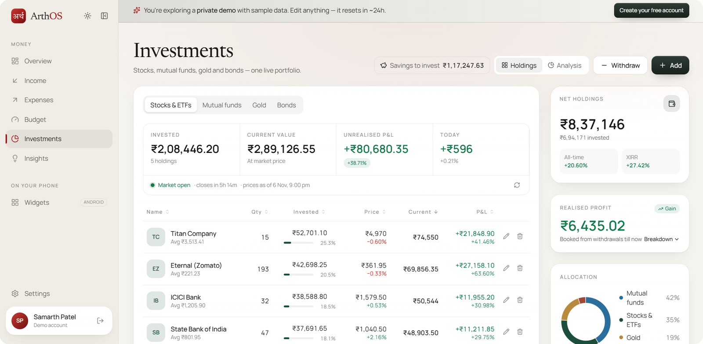
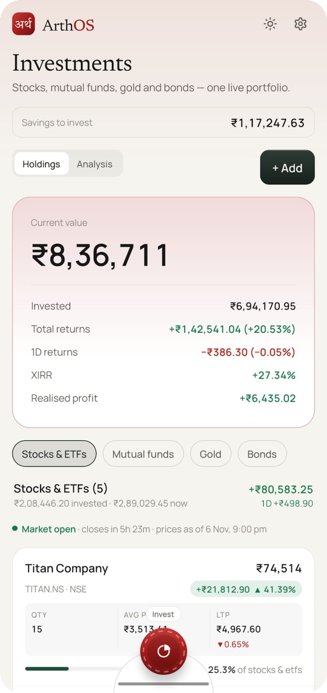
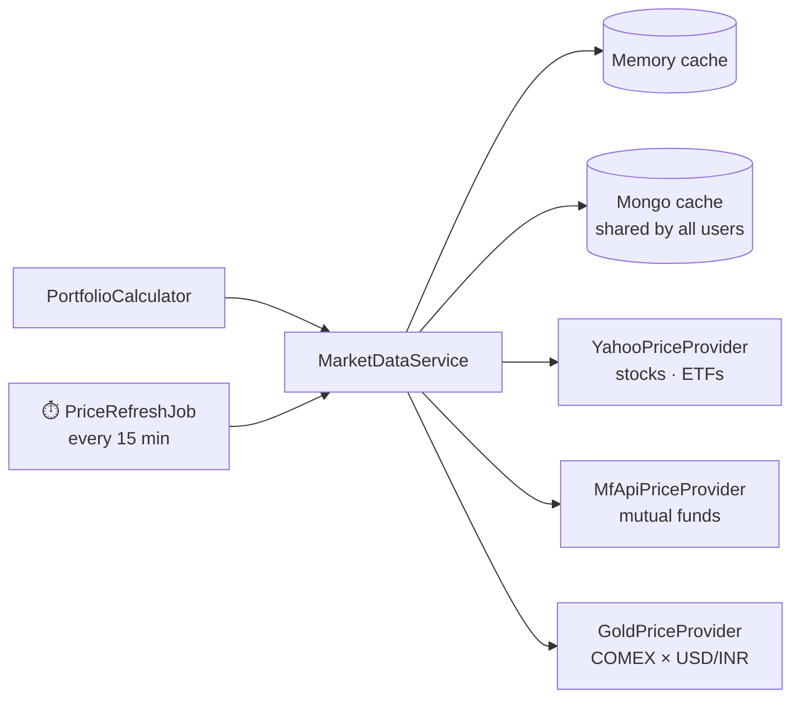

# 📈 Investments

[← Back to README](../README.md)

<table>
  <tr>
    <td width="72%"></td>
    <td width="28%"></td>
  </tr>
  <tr>
    <td align="center"><sub>🌐 Website</sub></td>
    <td align="center"><sub>📱 Android app</sub></td>
  </tr>
</table>

Track **stocks, ETFs, mutual funds, gold and bonds** in one portfolio, at live prices, with each investment linked to
how you paid for it (savings or spending money).

| Engine | Purpose |
|---|---|
| [`PortfolioCalculator`](../backend/src/main/java/com/arthos/portfolio/PortfolioCalculator.java) 🧮 | Value, P&L, day change, allocation, history |
| [`Xirr`](../backend/src/main/java/com/arthos/portfolio/Xirr.java) 🧮 | Annualised returns |
| [`HoldingIdentity`](../backend/src/main/java/com/arthos/portfolio/HoldingIdentity.java) 🧮 | "Is this the same instrument?" |
| [`MarketDataService`](../backend/src/main/java/com/arthos/market/MarketDataService.java) | Prices from swappable providers, cached |

---

## 🧺 Supported asset classes

| Class | Examples | Price source | Unit |
|---|---|---|---|
| 📊 **Stocks & ETFs** | RELIANCE, NIFTYBEES, ETERNAL | Yahoo Finance (NSE `.NS` / BSE `.BO`) | per share |
| 🧾 **Mutual funds** | Parag Parikh Flexi Cap – Direct Growth | **AMFI** NAVs via [mfapi.in](https://www.mfapi.in/) | per unit (NAV) |
| 🪙 **Gold** | Digital · Physical · Sovereign Gold Bonds (SGB) | COMEX gold × USD/INR → ₹ per gram 24K, × purity (22K = 91.6%) | per gram |
| 🏛️ **Bonds** | Government / corporate | Manual price or face value | per bond |

| Extra fields | |
|---|---|
| ⏳ **Horizon** | `SHORT` · `MEDIUM` · `LONG`, used by the *"by goal / horizon"* allocation view |
| 🪙 Gold | Form (digital/physical/SGB), purity, SGB series |
| 🏛️ Bonds | Type, coupon %, maturity date, face value |
| ✍️ Manual price | Override any live price, e.g. with your local jeweller's gold rate |

> ℹ️ The gold price excludes Indian import duty and GST, so it reads slightly below jewellers' rates. Use a manual price if you prefer.

---

## 🧾 Holdings & transactions (lots)

A **holding** is one instrument. It contains a list of dated **lots** (buy and sell transactions):

```text
📊 Reliance Industries (RELIANCE.NS)
 ├── BUY   10 @ ₹2,410   12 Jan 2026   💰 from savings
 ├── BUY    5 @ ₹2,655   03 Apr 2026   🔀 ₹10,000 savings + ₹3,275 spending
 └── SELL   4 @ ₹2,980   20 Sep 2026   → ₹11,920 back to savings
```

| Action | Notes |
|---|---|
| ➕ Add a holding | Search by name/ticker/fund. NSE is preferred, and each company appears once even though it's listed on both NSE and BSE. |
| 🔁 Buy again | If you add an instrument you already own, the purchase **joins the existing holding**. No duplicates. |
| ✏️ Edit a transaction | Change quantity, price/NAV, date, buy/sell and funding. |
| 🛡️ Chronology check | You can't save a change that would sell more than you held on that date: *"That would sell more than you held on…"* |
| 🗑️ Delete | A holding needs at least one transaction; delete the holding to remove the last one. |

### 🧬 When are two holdings "the same"?

| Class | Same instrument when… |
|---|---|
| Stocks/ETFs | Same ticker on either exchange (`ETERNAL.NS` = `ETERNAL.BO`) **or** the same company name ("Eternal Ltd." = "ETERNAL LIMITED") |
| Mutual funds | Same AMFI scheme code |
| Gold | Same form and purity (SGBs also need the same series) |
| Bonds | Same name |

Older data with duplicates is merged automatically: every transaction is kept and the copies are removed.

---

## 💳 Paying for an investment: savings or spending?

Investing is where the [save-first model](money-model.md) pays off. Each buy records **where the money came from**:

| Option | What happens | Example: buy worth ₹225 |
|---|---|---|
| ✨ **Savings first** *(default)* | Uses whatever the savings account holds; the rest comes from spending money | Savings has ₹150 → ₹150 savings + ₹75 spending |
| 🏦 **From savings** | The whole cost comes out of the savings account | ₹225 savings |
| 💸 **From spending** | Counted as this month's spending; savings untouched | ₹225 spending |
| 🔀 **Split** | You type how much comes from savings; the rest is spending | ₹150 savings + ₹75 spending |

```text
fromSavings  = savingsAmount (clamped between 0 and the cost)
fromSpending = cost − fromSavings
```

- 🏦 The savings part **reduces the savings account**.
- 💸 The spending part **reduces "left to spend"** for that month.
- 💹 **Sales** put the proceeds **back into savings**.

The form shows the live savings balance and warns you if a purchase would overdraw it.

---

## 🧮 The maths

### 💵 Average-cost P&L

```text
average cost   = total cost of units held ÷ units held     (updated on every buy)
realised gain  = (sell price − average cost) × units sold
unrealised P&L = (current price − average cost) × units held
```

### 💲 Which price is used?

```text
manual override  →  live quote (gold × purity)  →  face value (bonds)  →  last trade price
```

### 📈 XIRR (annualised return)

XIRR treats every buy as money going out, and every sale plus today's value as money coming in, then solves:

```text
Σ cashflowᵢ ÷ (1 + r)^(daysᵢ ÷ 365) = 0
```

It uses Newton–Raphson with a bisection fallback. For holdings younger than about a month, annualising gives absurd numbers, so
ArthOS shows the **simple return** instead.

### 📊 Day change, allocation & history

| Metric | How |
|---|---|
| Day change | (today's price − previous close) × units |
| Allocation | By asset class, and by horizon (short/medium/long) |
| Value vs invested chart | Rebuilt **day by day** from your lots and historical prices, so trend lines work from your first purchase |
| Ranges | 1M · 3M · 6M · 1Y · ALL |

---

## 📡 Market data



| Behaviour | Detail |
|---|---|
| 🔌 Swappable | Each class has a `PriceProvider`; a licensed feed can replace the free sources without changing the engine. |
| ⚡ Cached | Memory + MongoDB, so a restart doesn't hit every source again. |
| ⏱️ Kept warm | A background job refreshes every held symbol every 15 minutes. |
| 🛟 Resilient | If a source is down, the last good price is used. Short timeouts mean one slow source never stalls a page. |
| 🟢 Market status | The UI shows whether NSE is open or closed. |

---

## 🔌 API

| Method | Path |
|---|---|
| GET | `/api/portfolio?range=1M\|3M\|6M\|1Y\|ALL` |
| POST | `/api/holdings` |
| PUT / DELETE | `/api/holdings/{id}` |
| POST | `/api/holdings/{id}/lots` |
| PUT / DELETE | `/api/holdings/{id}/lots/{lotId}` |
| GET | `/api/market/search?q=&assetClass=` · `/api/market/quote?...` |

Full reference: [api.md](api.md#-investments)

## 🧪 Tested by

[`PortfolioCalculatorTest`](../backend/src/test/java/com/arthos/portfolio/PortfolioCalculatorTest.java) ·
[`HoldingIdentityTest`](../backend/src/test/java/com/arthos/portfolio/HoldingIdentityTest.java)
