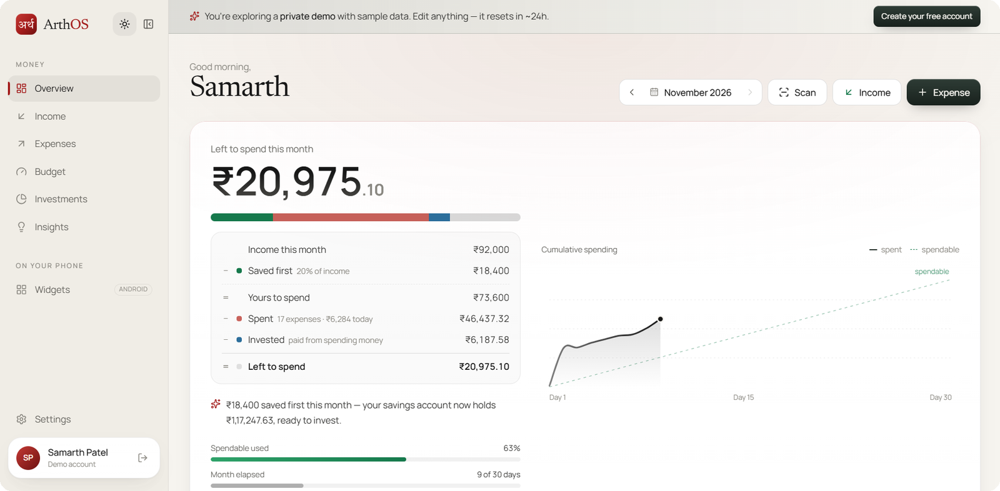
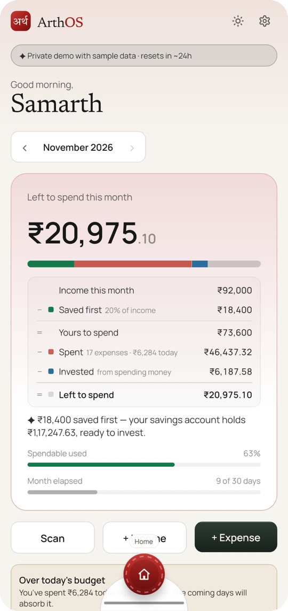
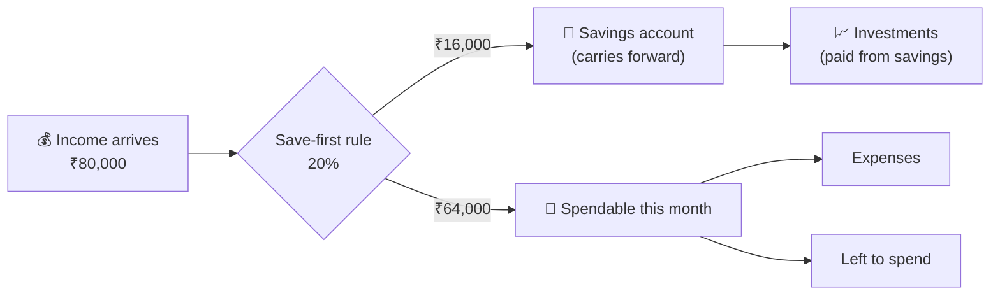

# 🏦 Money Model: Income, Spending & Save-First

[← Back to README](../README.md)


<table>
  <tr>
    <td width="72%"></td>
    <td width="28%"></td>
  </tr>
  <tr>
    <td align="center"><sub>🌐 Website</sub></td>
    <td align="center"><sub>📱 Android app</sub></td>
  </tr>
</table>

This page explains how ArthOS turns your incomes, expenses and investments into the numbers on the **Overview** screen.
Most features build on it, including the budget, insights and investment funding.

---

## 💡 The core idea: pay yourself first

Most trackers calculate savings at the end of the month as *whatever is left*. That usually means nothing is left.

ArthOS works the other way round, as most financial advice recommends:

> **The moment income arrives, a part of it is set aside as savings. Only the rest is yours to spend.**



---

## ⚙️ The save-first rule

You choose the rule during onboarding and can change it in **Settings**. It lives in [`SavingsRule`](../backend/src/main/java/com/arthos/user/SavingsRule.java).

| Mode | Example | How much is set aside |
|---|---|---|
| **% of income** *(default 20%)* | 20% | `income × 20 ÷ 100` for each month's income |
| **Fixed amount** | ₹15,000 | `min(₹15,000, income received)`: money that hasn't arrived can't be saved |

```text
savedFirst  = rule.setAside(this month's income)
spendable   = income − savedFirst
```

> ✏️ The rule is applied to the **total income of the month**, so with a % rule the savings grow as more income arrives.

---

## 🧾 The month summary

[`MonthSummaryCalculator`](../backend/src/main/java/com/arthos/summary/MonthSummaryCalculator.java) produces everything on the Overview screen:

| Field | Formula / meaning |
|---|---|
| `totalIncome` | Sum of the month's incomes |
| `savedFirst` | Save-first rule applied to `totalIncome` |
| `spendable` | `totalIncome − savedFirst` |
| `totalExpense` | Sum of the month's expenses |
| `investedThisMonth` | All buys this month, whichever pot paid for them |
| `leftToSpend` | `spendable − totalExpense − investments paid from spending money`. **Negative** means spending ate into savings. |
| `savingsRate` | `(income − expense) ÷ income × 100` (null with no income) |
| `averageDailyExpense` | `totalExpense ÷ days elapsed` |
| `expenseByCategory` | Totals and share % per category |
| `dailyExpense` | One entry per elapsed day (zero-filled for continuous charts) |
| `recent` | Latest incomes and expenses mixed |

### 🧮 Worked example

| | Amount |
|---|---|
| Salary on 1 Nov | ₹80,000 |
| Rule: 20% | |
| **Saved first** | ₹16,000 |
| **Spendable** | ₹64,000 |
| Expenses so far | ₹41,250 |
| SIP ₹5,000 paid **from savings** | (doesn't touch spendable) |
| Gold ₹2,000 paid **from spending** | −₹2,000 |
| **Left to spend** | 64,000 − 41,250 − 2,000 = **₹20,750** |

---

## 🏦 The savings account (carries forward)

The savings account is a **running balance across months**. It is calculated from scratch every time, never stored, so
editing an old income or investment updates every month after it. Logic: [`SavingsAccount`](../backend/src/main/java/com/arthos/savings/SavingsAccount.java).

```text
opening(month) = closing(previous month)       first month: your starting balance
closing(month) = opening + savedFirst − buys paid from savings + sale proceeds
```

| Movement | Effect on savings account |
|---|---|
| 💰 Income arrives | ➕ `savedFirst` |
| 📈 Buy paid **from savings** | ➖ the savings part of the cost |
| 💸 Buy paid **from spending money** | No change; counted as that month's spending instead |
| 💹 Sell | ➕ the sale proceeds return to savings |
| 🏁 Starting balance (Settings) | Savings you had **before** you started tracking |

### 📅 Example across three months

| Month | Opening | + Saved first | − Invested from savings | + Sales | = Closing |
|---|---|---|---|---|---|
| Sep | ₹60,000 *(starting balance)* | ₹16,000 | ₹10,000 | — | ₹66,000 |
| Oct | ₹66,000 | ₹16,000 | ₹25,000 | — | ₹57,000 |
| Nov | ₹57,000 | ₹16,000 | ₹5,000 | ₹8,000 | **₹76,000** |

The Overview and Investments screens show the last 6 months of this history.

> ⚠️ **Overdrawn?** If you invest more from savings than the account holds, the closing balance goes negative.
> Insights raises a **"Savings overdrawn"** alert, and the investment form warns you before you save.

---

## 💰 Income

| Field | Values |
|---|---|
| Type | `SALARY` · `FREELANCE` · `BONUS` · `INTEREST` · `DIVIDEND` · `CASH` · `REFUND` · `OTHER` |
| Recurring | Mark salary and similar income. [Recurring detection](automation.md#-recurring-detection) suggests the ones you forgot. |
| Date | Decides the month (`monthKey = YYYY-MM`). |

## 💸 Expenses

| Field | Values |
|---|---|
| Category | `FOOD` · `GROCERIES` · `TRANSPORT` · `RENT` · `UTILITIES` · `SHOPPING` · `ENTERTAINMENT` · `HEALTH` · `EDUCATION` · `SUBSCRIPTIONS` · `EMI` · `TRAVEL` · `PERSONAL_CARE` · `GIFTS` · `OTHER` |
| Payment source | `UPI` · `CREDIT_CARD` · `DEBIT_CARD` · `CASH` · `BANK_TRANSFER` · `WALLET` · `OTHER` |
| Merchant | Free text; drives [smart categories](automation.md#-smart-categories). |
| Search & filters | Text search, category, min/max amount, month. |

---

## 🧪 Tested by

[`MonthSummaryCalculatorTest`](../backend/src/test/java/com/arthos/summary/MonthSummaryCalculatorTest.java) ·
[`SavingsAccountTest`](../backend/src/test/java/com/arthos/savings/SavingsAccountTest.java)
