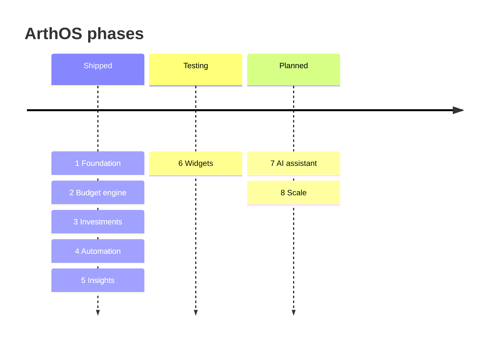

# 🗺️ Roadmap

[← Back to README](../README.md)

ArthOS follows the eight phases in the product blueprint
([`docs/product-blueprint.docx`](product-blueprint.docx)).

| Phase | Theme | Status | Backend | Web | App |
|---|---|---|---|---|---|
| 1 | 🧱 Foundation | ✅ | ✅ | ✅ | ✅ |
| 2 | 🎯 Budget engine | ✅ | ✅ | ✅ | ✅ |
| 3 | 📈 Investments | ✅ | ✅ | ✅ | ✅ |
| 4 | 📸 Automation | ✅ | ✅ | ✅ | ✅ |
| 5 | 💡 Insights | ✅ | ✅ | ✅ | ✅ |
| 6 | 🧩 Widgets | 🧪 Testing | ✅ | — | ✅ |
| 7 | 🤖 AI assistant | 📝 Planned | | | |
| 8 | 🚀 Scale | 📝 Planned | | | |

---

## ✅ Phase 1: Foundation

| Delivered | |
|---|---|
| 🔐 Email/password sign-up and login (JWT), **Google sign-in** | ✅ |
| 🧭 First-run onboarding: currency, timezone, save-first rule | ✅ |
| 💰 Income and 💸 expense entry, edit, delete, search, filters | ✅ |
| 🏠 Overview dashboard with empty states | ✅ |
| 🗂️ Month-based storage in MongoDB | ✅ |
| 🧪 Demo sandbox (self-deleting) and a marketing landing page | ✅ |
| 🏦 Save-first savings account that carries forward | ✅ *(added later)* |

## ✅ Phase 2: Budget engine → [budget.md](budget.md)

Monthly-to-daily conversion · fixed / adaptive / weekly modes · overspend spread across the remaining days · warnings ·
calendar history · step-by-step explanation.

## ✅ Phase 3: Investments → [investments.md](investments.md)

Stocks/ETFs, mutual funds, gold, bonds · live prices · P&L, XIRR, day change · allocation by class and **by goal/horizon** ·
value-vs-invested trend · split funding from savings/spending · editable transactions · duplicate merging.

## ✅ Phase 4: Automation → [automation.md](automation.md)

On-device OCR for screenshots, SMS and receipts · **Share → ArthOS** · confirm before saving · learned categories ·
recurring detection.

## ✅ Phase 5: Insights → [insights.md](insights.md)

Monthly summary in plain words · category trends · anomalies · subscription leakage · **health score with explanations** ·
alerts · suggestions · phone notifications for budget overages and bill due dates.

---

## 📥 Broker import (added)

Import holdings and tradebooks from Zerodha, Groww and other brokers, and every mutual fund from a CAS. Files are read on the device and never uploaded. → [investments.md](investments.md#-import-from-your-broker)

## 🧪 Phase 6: Widgets → [widgets.md](widgets.md)

> *Blueprint: "Deliver small and medium widgets with budget and portfolio information. Allow widget configuration per user preference. Ensure widget values refresh reliably."*

| Built | Size | Shows |
|---|---|---|
| 🎯 Safe to spend today | 2×2 | Today's allowance and status colour |
| 📊 Month snapshot | 4×2 | Spent vs budget bar, left to spend, saved first |
| 📈 Portfolio | 2×2 | Value, day change, overall gain |
| ⚡ Quick add | 2×1 | One tap → add expense / scan / income |
| ⚙️ Configuration | | Per-widget theme (match app / Forest / Ivory) and hide amounts |
| 🔄 Reliable refresh | | Every 30 min, after every save, on app open; last good values cached |

## 📝 Phase 7: AI assistant

> *Blueprint: "Add a conversational assistant for personal finance questions. Use AI to explain why spending changed and how to improve savings."*

| Idea | Notes |
|---|---|
| 💬 **Ask ArthOS** chat | *"Can I afford a ₹40k trip in March?"*, *"Why was October expensive?"* |
| 🧮 Grounded in the calculators | Sends the already-computed numbers (summary, budget, insights) rather than raw transactions, so answers stay accurate and private |
| 🎛️ Opt-in | Today's rule-based [Insights](insights.md) stay the default |

## 📝 Phase 8: Scale

> *Blueprint: "Add goal planning, family sharing, document storage, and future asset classes."*

| Idea | |
|---|---|
| 🎯 Goals | Target amount and deadline, with progress and expected completion date |
| 👨‍👩‍👧 Family sharing | Shared budgets and household view |
| 📄 Documents | Store statements, policies, receipts |
| 🧾 Net worth with liabilities | Loans, credit-card dues, EMIs outstanding |
| 🪙 More asset classes | FDs, PPF/EPF, NPS, real estate, crypto |
| 💎 Premium & scale | Licensed market data, push notifications, iOS app |

---

## 🧩 Backlog / nice-to-have

| Item | |
|---|---|
| 📸 Product screenshots in the docs | 🔜 |
| 📤 CSV / PDF export | |
| 🏦 Bank statement import | |
| 🌍 Multi-currency portfolios | |
| ♿ Accessibility pass (screen readers, contrast) | |
| 🧪 End-to-end tests for web and app | |
