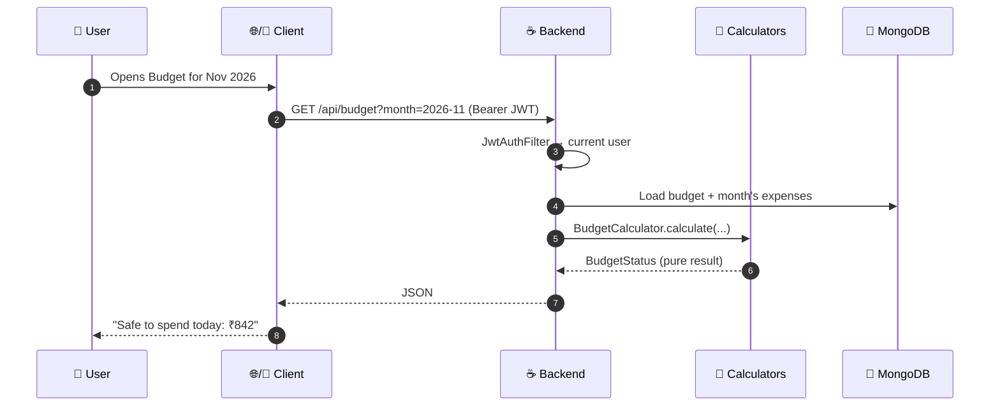

# 🧰 Tech Stack & Architecture

[← Back to README](../README.md)

ArthOS has three independent projects that share one REST API:

| Part | Folder | Hosted on | Who uses it |
|---|---|---|---|
| ☕ **Backend** | [`backend/`](../backend) | Render (Docker) at `arthos-9tro.onrender.com` | The website and the app |
| 🌐 **Website** | [`web/`](../web) | Vercel at [os-arth.vercel.app](https://os-arth.vercel.app/) | Desktop and mobile browsers |
| 📱 **App** | [`app/`](../app) | APK on [GitHub Releases](https://github.com/SamP231004/ArthOS/releases/tag/android-latest) | Android phones |

---

## 🗺️ The big picture



Every screen follows the same pattern: the **controller** loads data from MongoDB, hands it to a **pure calculator**
(plain Java with no Spring and no database), and returns the result. The clients only display what the backend calculated,
so the website and the app always show the same numbers.

---

## ☕ Backend

| Tech | Version | Why |
|---|---|---|
| **Java** | 21 | Records, switch expressions, pattern matching: the calculators are mostly records. |
| **Spring Boot** | 3.5.16 | REST controllers, validation, scheduling, security filters. |
| **Spring Data MongoDB** | (Boot) | Repositories, automatic index creation, `Decimal128` for money. |
| **MongoDB Atlas** | managed | Document storage suits holdings-with-lots and per-month data. |
| **JJWT** | 0.12.6 | Stateless JWT auth (7-day tokens by default). |
| **Google ID token verification** | | "Continue with Google" on web and app. |
| **JUnit 5 + Spring test** | | Calculator unit tests and web-layer tests that need no database. |
| **Docker** | multi-stage | Built and deployed by Render from [`render.yaml`](../render.yaml). |

### 📦 Packages

| Package | Responsibility | Key classes |
|---|---|---|
| `auth` | Register, login, Google sign-in, demo, JWT filter | `AuthController`, `JwtService`, `JwtAuthFilter`, `GoogleTokenVerifier` |
| `user` | Profile, currency, timezone, save-first rule | `User`, `SavingsRule`, `UserController` |
| `income` / `expense` | CRUD with month grouping | `Income`, `Expense`, `ExpenseCategory`, `PaymentSource` |
| `summary` | Month overview | `MonthSummaryCalculator` 🧮 |
| `savings` | Carry-forward savings account | `SavingsAccount` 🧮, `SavingsService` |
| `budget` | Daily/weekly allowance engine | `BudgetCalculator` 🧮 |
| `portfolio` | Holdings, lots, P&L, XIRR, history | `PortfolioCalculator` 🧮, `Xirr` 🧮, `HoldingIdentity` 🧮 |
| `market` | Prices behind a swappable interface | `PriceProvider`, `YahooPriceProvider`, `MfApiPriceProvider`, `GoldPriceProvider`, `MarketDataService`, `PriceRefreshJob` |
| `automation` | Text → transaction, categories, recurring | `TransactionTextParser` 🧮, `CategoryRules`, `CategoryLearner`, `RecurringDetector` 🧮 |
| `insights` | Summaries, health score, alerts | `InsightsCalculator` 🧮 |
| `demo` | Self-deleting sandbox accounts | `DemoService`, `DemoData`, `DemoPortfolio`, `DemoRateLimiter` |
| `common` / `config` | Errors, CORS, security, scheduling | `GlobalExceptionHandler`, `SecurityConfig` |

🧮 = a pure calculator: no I/O, fully unit-tested.

---

## 🌐 Website

| Tech | Version | Why |
|---|---|---|
| **Next.js** (App Router) | 16 | File-based routing, fast builds with Turbopack, Vercel-native. |
| **React** | 19 | With the React Compiler lint rules (no manual memoisation). |
| **Tailwind CSS** | v4 | Design tokens as CSS variables, so the theme switches instantly. |
| **TanStack Query** | 5 | Server state: caching, refetching, invalidation after every save. |
| **Zustand** | 5 | Small client state: auth token, selected month, theme. |
| **Tesseract.js** | 6 | OCR **in the browser**, so screenshots never leave the device. |
| **lucide-react** | | Icons. |

Routes: `/` (landing) · `/login` · `/register` · `/onboarding` · `/dashboard` (Overview) · `/dashboard/income` ·
`/dashboard/expenses` · `/dashboard/budget` · `/dashboard/investments` · `/dashboard/insights` · `/dashboard/settings`.

---

## 📱 Android app

| Tech | Version | Why |
|---|---|---|
| **Expo** | SDK 58 | Managed native builds, config plugins, EAS signing. |
| **React Native** | 0.88 (New Architecture) | |
| **Expo Router** | 58 | File-based routes; `Stack.Protected` guards signed-in screens. |
| **TanStack Query + Zustand** | 5 / 5 | Same data layer as the website. |
| **react-native-svg** | 15 | Charts, rings, the dial. |
| **react-native-reanimated** | 4 | The dial tab bar and the theme reveal animation. |
| **react-native-view-shot** | 6 | Snapshots the screen for the smooth light/dark reveal. |
| **expo-secure-store** | | JWT and notification bookkeeping stored encrypted. |
| **expo-sharing** | | Receives **Share → ArthOS** from GPay, PhonePe, Messages… |
| **expo-notifications** | | Local alerts and bill reminders (no push server). |
| **Google ML Kit** (bundled) | 16.0.1 | On-device text recognition via a local Expo module, [`modules/arthos-ocr`](../app/modules/arthos-ocr). |
| **@react-native-google-signin** | 17 | Native Google sign-in. |
| **Fonts** | | Newsreader (display), Manrope (UI), IBM Plex Mono (numbers), Tiro Devanagari (अर्थ). |

---

## 🗃️ Data model

```mermaid
erDiagram
    USER ||--o{ INCOME : earns
    USER ||--o{ EXPENSE : spends
    USER ||--o| BUDGET : "sets (carries forward)"
    USER ||--o{ HOLDING : owns
    HOLDING ||--|{ LOT : "buy/sell transactions"
    USER ||--o{ MERCHANT_RULE : "teaches categories"
    MARKET_CACHE }o--o{ HOLDING : "prices"

    USER { string email; string currency; string timezone; enum savingsMode; decimal savingsValue; decimal savingsStartingBalance; bool demo }
    INCOME { decimal amount; enum type; date date; string monthKey; bool recurring }
    EXPENSE { decimal amount; enum category; string merchant; enum paymentSource; date date; string monthKey; bool recurring }
    BUDGET { string month; decimal limit; enum mode; list excludedCategories }
    HOLDING { enum assetClass; string symbol; string name; enum horizon; decimal manualPrice }
    LOT { enum type; date date; decimal quantity; decimal price; enum fundedFrom; decimal savingsAmount }
```

| Decision | Why |
|---|---|
| 💵 Money is stored as **`Decimal128`** (`BigDecimal` in Java) | No floating-point rounding errors in balances. |
| 📅 Every income/expense stores a **`monthKey`** (`YYYY-MM`) | Month screens are a single indexed query on `{userId, monthKey, date}`. |
| 📦 Lots live **inside** their holding | One document = one instrument with its full history, read in one go. |
| 🏦 The savings account is **calculated, not stored** | It's always consistent with incomes and lots: edit an old income and every later month updates. |
| ⏳ Demo users have an `expiresAt` **TTL index** | MongoDB deletes demo data automatically after 24 h. |

---

## 🔐 Security

| Concern | How it's handled |
|---|---|
| Passwords | BCrypt hashes, never returned. |
| Sessions | Stateless JWT (`Authorization: Bearer …`), 7-day expiry, secret from `JWT_SECRET`. |
| Google sign-in | The ID token is verified server-side against the configured client IDs. |
| Data isolation | Every query is scoped by the signed-in `userId`; other users' IDs return 404. |
| CORS | Only origins in `CORS_ALLOWED_ORIGINS`. |
| Demo abuse | At most 10 demo accounts per IP per hour (sliding window). |
| Receipts & screenshots | **Never uploaded.** OCR runs on the device, and only the extracted text is sent for parsing. |
| Broker files & CAS | **Never uploaded.** Read and matched on the device (pdf.js / PDFBox for PDFs); only the holdings you confirm are saved. |
| Secrets | `.env` files are gitignored; production secrets live in Render/Vercel/GitHub settings. |

---

## 🧭 Principles

1. **🧮 Pure maths, tested.** Every number on screen comes from a calculator that can be unit-tested without a server.
2. **🔁 One source of truth.** Clients never recalculate money; the backend decides and both clients display it.
3. **🗣️ Explain, don't just show.** Budget and health screens explain how each number was reached.
4. **🔒 Private by default.** On-device OCR and broker-file import, no external AI, no third-party analytics.
5. **🔌 Swappable providers.** Price sources sit behind `PriceProvider`, so a licensed feed can replace free sources without touching the engine.
6. **📱 Mirror the web.** The app uses the same palette, wording and layout as the website.
