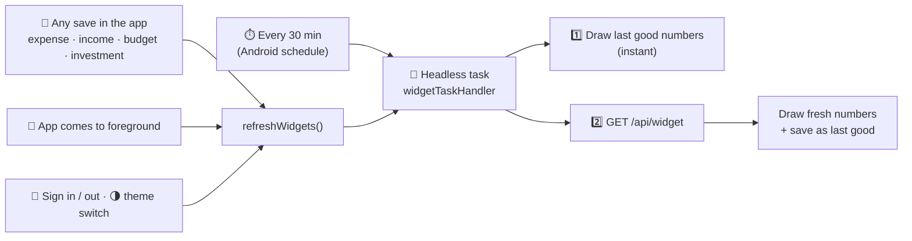

# 🧩 Home-Screen Widgets (Android)

[← Back to README](../README.md)

> *Blueprint, Phase 6: "Deliver small and medium widgets with budget and portfolio information. Allow widget configuration per user preference. Ensure widget values refresh reliably."*

Check your money without opening the app. Long-press the home screen → **Widgets** → **ArthOS**.

---

## 🧱 The four widgets

| Widget | Default size | Shows | Tap opens |
|---|---|---|---|
| 🎯 **Safe to spend** | 2 × 2 | Today's safe-to-spend in the status colour, today's allowance, days left, a month-used bar | Budget |
| 📊 **Month snapshot** | 4 × 2 | Spent vs budget with a bar, **left to spend** (and per day), **saved first**, safe today | Home |
| 📈 **Portfolio** | 2 × 2 | Portfolio value, **today's move** ▲/▼, overall gain, number of holdings | Invest |
| ⚡ **Quick add** | 2 × 1 | **+ Expense** and **Scan** buttons (**+ Income** too when made taller) | That screen |

All widgets are **resizable**, and they all have empty and signed-out states: *"Set a budget"*, *"No investments yet"*, *"Sign in to ArthOS"*.

### 🚦 Colours

| Status | Colour |
|---|---|
| On track | 🟢 green |
| Careful (80–100% of today's allowance) | 🟡 amber |
| Over today / over budget | 🔴 red |

---

## ⚙️ Settings per widget

Long-press a widget → **Settings** (shown automatically the first time on some launchers):

| Option | Choices |
|---|---|
| 🎨 **Theme** | **Match the app** (follows the ☀️/🌙 switch) · 🌲 **Forest** · 🕊️ **Ivory** |
| 🙈 **Hide amounts** | Shows `₹ ••••` on the home screen, for privacy; open the app to see the numbers |

Settings are stored **per widget**, so you can have a hidden-amounts Safe-to-spend on the home screen and a full Month snapshot elsewhere.
The settings screen draws a **live preview** on the widget as you change options.

---

## 🔄 How values stay fresh



| Guarantee | How |
|---|---|
| ⚡ **Never blank** | The last good snapshot is stored on the device and drawn first; fresh numbers replace it |
| 📴 **Offline / server waking** | Keeps showing the last snapshot with *"as of 9:41 am"* |
| 🔁 **Same numbers as the app** | `/api/widget` is built from the same calculators as the Budget, Overview and Investments screens |
| 🧮 **One request per refresh** | One small endpoint returns everything every widget needs; it's fetched once and shared across all placed widgets |
| 🔋 **Battery-friendly** | Android's 30-minute minimum schedule, and refreshes from the app are debounced and shared |
| 🔐 **No separate login** | The headless task reads the app's session from the encrypted SecureStore; signing out turns widgets into *"Sign in"* |

---

## 🛠️ How it's built

| Piece | File |
|---|---|
| Library | [`react-native-android-widget`](https://github.com/sAleksovski/react-native-android-widget): widgets written in JSX, rendered to native Android **RemoteViews** |
| Widget registration (sizes, labels, 30-min updates, fonts) | [`app/app.json`](../app/app.json) plugin config |
| Entry point registering the task handler and settings screen | [`app/index.ts`](../app/index.ts) |
| Layouts (Forest/Ivory tokens, Manrope + Newsreader fonts) | [`src/widgets/widgets.tsx`](../app/src/widgets/widgets.tsx) |
| Headless handler + `refreshWidgets()` | [`src/widgets/task-handler.tsx`](../app/src/widgets/task-handler.tsx) |
| Session, snapshot cache, per-widget prefs | [`src/widgets/data.ts`](../app/src/widgets/data.ts) |
| Settings screen | [`src/widgets/config-screen.tsx`](../app/src/widgets/config-screen.tsx) |
| App-side triggers (mutations, foreground, auth, theme) | [`src/app/_layout.tsx`](../app/src/app/_layout.tsx) · [`src/widgets/refresh.ts`](../app/src/widgets/refresh.ts) |
| Backend snapshot | [`WidgetController`](../backend/src/main/java/com/arthos/widget/WidgetController.java) → `GET /api/widget` |

### 📦 `GET /api/widget`

```json
{
  "month": "2026-11", "currency": "INR", "today": "2026-11-07",
  "budget":   { "configured": true, "todayRemaining": 149.5, "todayAllowance": 1280.86, "usedPct": 26.0,
                "status": "CAUTION", "limit": 40000, "daysRemaining": 24, "...": "…" },
  "money":    { "income": 92000, "spent": 36889.49, "savedFirst": 18400, "leftToSpend": 30460.58, "perDayLeft": 1269 },
  "portfolio":{ "value": 834075.84, "gain": 140080.26, "gainPct": 20.18, "dayChange": 2427.65, "dayChangePct": 0.29, "holdingsCount": 13 },
  "generatedAt": "2026-11-07T16:32:04Z"
}
```

`portfolio` is omitted when there are no investments. The backend's reads run in parallel, so the endpoint answers in a single round trip.

---

## 🔗 Deep links used by widgets

| Link | Opens |
|---|---|
| `arthos://` | Home |
| `arthos://budget` | Budget tab |
| `arthos://invest` | Investments tab |
| `arthos://expense-form` | New expense |
| `arthos://income-form` | New income |
| `arthos://scan` | Scan a screenshot |

> ℹ️ Widgets are Android-only: a website can't place widgets on a home screen, and the iOS app isn't built yet ([roadmap](roadmap.md)).
> The website's **Widgets** page (`/dashboard/widgets`, also linked from Settings) previews all four with your live numbers, using the same `/api/widget` snapshot, and explains how to add them.
